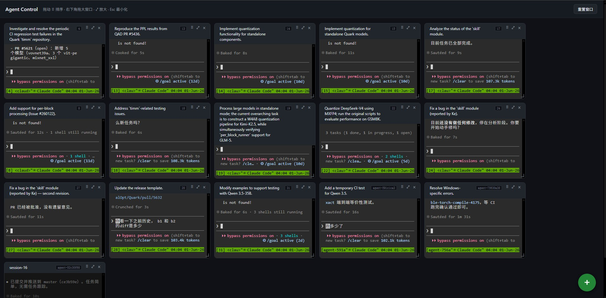

# Managing Many Agents at Once: Why I Built TMUX Ctl

## Background

Lately I've been relying on Claude's `/goal` and Ralph-style "autonomous loop" workflows: you give the agent a goal, and it loops on its own, making incremental progress.

My approach is to write a fairly complete task list, break it into items with clear acceptance criteria, and hand it off for autonomous execution. To boost throughput, I usually **run several agents in parallel** — one fixing CI, one adding tests, one refactoring, one running experiments. In theory a big efficiency win; in practice, it quickly exposed new problems.

## The Pain: Invisible State, Hard to Intervene

With more agents, two problems kept recurring:

- **Drifting off course.** An agent interprets a task differently from what I intended and keeps pushing the wrong way. By the time I notice, it has burned a lot of tokens.
- **Stalling silently.** An agent gets stuck and stops progressing — maybe waiting on input that never comes, maybe failing quietly. From the outside it's hard to tell whether it's still working or unresponsive.

Running in parallel amplifies all of this. I had to switch constantly between terminal tabs, SSH sessions, and tmux panes to check each agent. By the time I reached the fourth, the first might have drifted for minutes — the parallelism meant to help had turned me into a bottleneck with no view of the whole.

What I really needed was just two things: **see each agent's state in real time**, and **step in, interrupt, and steer it back at any moment**. No existing tool fit, so I built one — **TMUX Ctl**.

> **A note:** There may well be mature open-source tools for this; I didn't do an exhaustive survey. I simply preferred to tailor exactly what fits my workflow — simple and efficient, rather than do-everything. If it fits your case too, you're welcome to use it.

## TMUX Ctl: Every Agent on a Single Screen

TMUX Ctl is a minimal multi-terminal web control panel. The core idea in one line: **bring all of your agents together onto a single screen.**

Each agent runs in its own live terminal cell, laid out as a grid in the browser. One glance tells you which agents are progressing, which are waiting, and which need attention. Its main value:

- **Full visibility.** Every agent's state shown together — no more checking one by one.
- **Interactive and interruptible.** Each cell is a **fully interactive terminal**; when an agent drifts, step in to type commands, send Ctrl-C, or change direction — no starting from scratch.
- **Spot stalls early.** Cells that haven't changed in a while stand out, so you can intervene before resources are wasted.
- **Progress persists.** Sessions run on tmux, so refreshing, restarting, or switching devices never loses your workspace.
- **Accessible anywhere.** It's just a web page — check on agents from a laptop, tablet, or phone.

## Closing

With TMUX Ctl, I went from an inspector pacing the factory floor to someone sitting in a control room: every status in front of me, quick to pinpoint and step in. Parallel agents finally became a multiplier of efficiency rather than a drain on attention.

If you also use `/goal`, Ralph, or any multi-agent parallel approach and have been frustrated by invisible state and the inability to intervene, TMUX Ctl may be the missing piece you need.

## Repository

> **https://gitenterprise.xilinx.com/meng/tmux_ctl**

Lightweight and easy to deploy — running in minutes. Feedback and contributions welcome.
